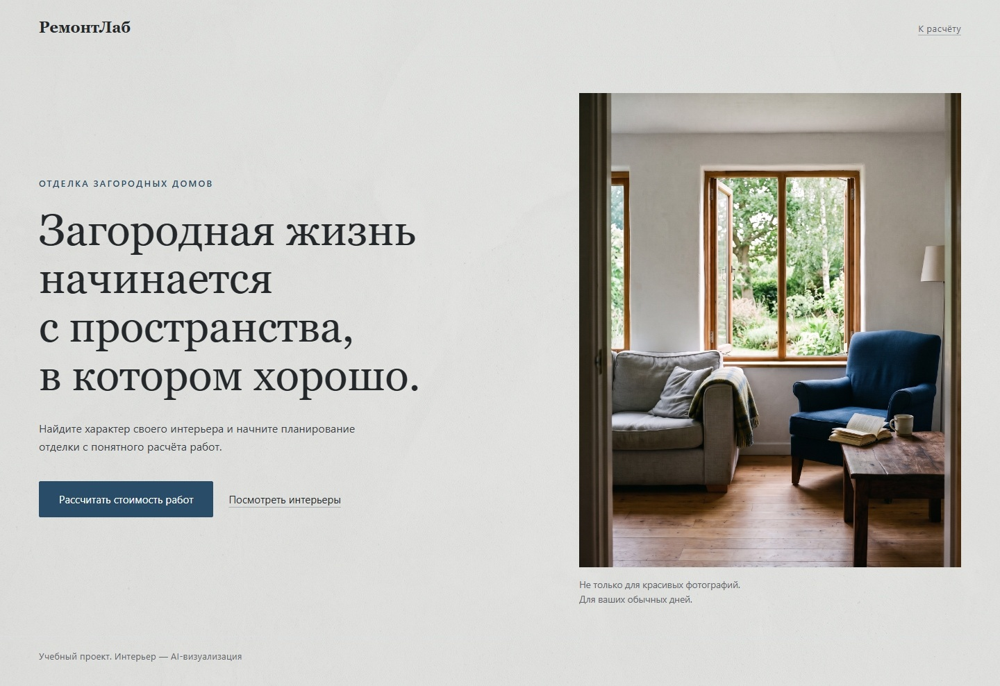
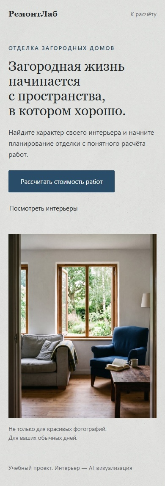
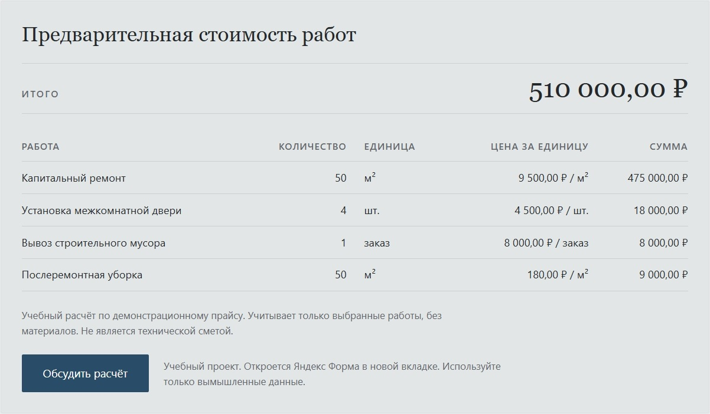
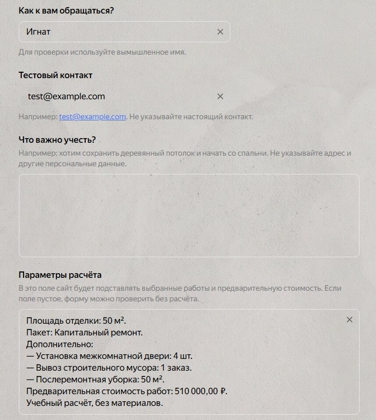
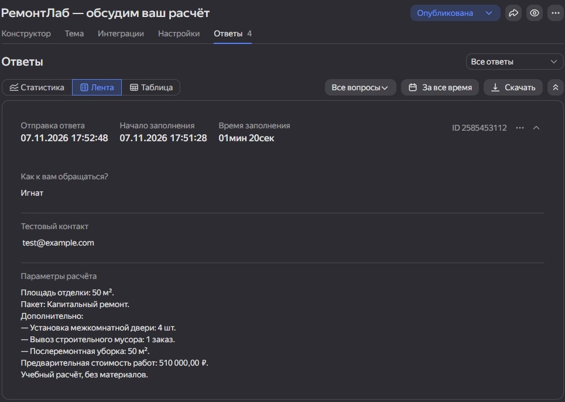

# РемонтЛаб — лендинг с калькулятором отделки

Учебный проект Натальи Марковой / NaMark-design: адаптивный лендинг с калькулятором предварительной стоимости отделки загородного дома и передачей сводки в Яндекс Форму.

**Демо:** https://remontlab.netlify.app/

Проект создан для обучения и портфолио. Это не реальная строительная компания. Цены демонстрационные, заказы на ремонт не принимаются. При проверке формы используйте только вымышленные данные.

## Задача и аудитория

Показать законченный сценарий: знакомство с предложением → выбор параметров → предварительный расчёт → заявка с сохранённой сводкой. Предполагаемая аудитория демонстрационного сайта — владельцы загородных домов. Реального заказчика у проекта нет.

## Возможности

- Адаптивный первый экран и раздел интерьерных иллюстраций.
- Три пакета ремонта и шесть дополнительных услуг.
- Валидация площади, выбора пакета и количества работ.
- Итог и детализация по строкам с форматированием в рублях.
- Инвалидация результата и ссылки при изменении параметров.
- Предзаполнение видимого поля Яндекс Формы через URL.
- Открытие формы в новой вкладке только по нажатию посетителя.
- Управление с клавиатуры и видимый фокус.

## Демонстрация

### Первый экран


### Узкий экран


### Расчёт с детализацией


### Предзаполненная форма


### Полученный тестовый ответ


### Подтверждение отправки


На снимках калькулятора и формы показан один пример: 50 м², капитальный ремонт, 4 двери, вывоз мусора и уборка. Итог — 510 000,00 ₽. Это отдельный демонстрационный сценарий, не контрольный T02.

## Технологии и структура

HTML, CSS (Grid, Flexbox, медиазапросы), JavaScript ES-модули, Node.js node:test, Яндекс Формы, Netlify. Сборщик и npm-зависимости для сайта не используются.

```text
.
├── README.md
├── .gitignore
├── index.html
├── styles.css
├── assets/
│   ├── first.jpg
│   ├── kitchen.jpg
│   ├── bedroom.jpg
│   └── mineral-texture.jpg
├── js/
│   ├── calculator-core.mjs
│   ├── calculator-ui.mjs
│   ├── demo-price.mjs
│   └── yandex-form.mjs
├── tests/
│   └── web-calculator.test.mjs
└── docs/screenshots/
```

- `calculator-core.mjs` — валидация и расчёты.
- `demo-price.mjs` — статический учебный прайс.
- `calculator-ui.mjs` — интерфейс, отображение и структурированная сводка.
- `yandex-form.mjs` — текст сводки и построение ссылки.

Расчётное ядро переиспользовано из ранее созданного настольного учебного проекта «РемонтЛаб». Веб-версия использует статический демонстрационный прайс, а не онлайн-прайс настольного приложения.

## Как работает передача данных

После успешного расчёта появляется «Обсудить расчёт». В URL формы передаются площадь, пакет, услуги, количества, итог и учебное предупреждение. Имя и контакт сайт в URL не добавляет.

При изменении параметров старый результат скрывается, сводка очищается, href ссылки удаляется. Для перехода с новыми данными требуется повторный расчёт. Автоматической отправки формы нет.

Адрес формы, имя параметра и ограничение длины URL заданы в `js/yandex-form.mjs`. URL формируется через `URL` и `URLSearchParams`. Для другого экземпляра формы нужны её собственные адрес и идентификатор поля.

## Локальный запуск

Понадобится Python 3 или другой локальный HTTP-сервер. Из корня проекта в Windows:

```powershell
py -3 -m http.server 8123 --bind 127.0.0.1
```

Откройте http://127.0.0.1:8123/ . Не запускайте index.html через file://: сайт использует ES-модули. Для внешней формы нужен интернет.

## Автоматические тесты

Понадобится Node.js с поддержкой node:test. Проверенная автором версия — v26.13.0.

```powershell
node --test tests/
```

Или:

```powershell
node --test tests/web-calculator.test.mjs
```

7 ноября 2026 года автор локально запустила 41 проверку: все пройдены. Проверяются расчёты, валидация, прайс и разметка, форматирование, сериализация, параметры формы, сохранение кириллицы и специальных символов, длина URL и некорректная сводка.

Контрольный T02: 50 м², стандартный ремонт, демонтаж 20 м², 4 электрические точки, вывоз мусора и уборка. Ожидаемый итог учебного прайса — 352 600,00 ₽. Это не рыночная оценка ремонта.

## Ручная проверка и результат

Автор проверила локальную и опубликованную версии: контрольные расчёты, предзаполнение, повторный расчёт, скрытие устаревшей ссылки, ошибки ввода, сброс, клавиатуру и узкое окно около 390 px. Отправлен ответ с тестовыми контактными данными; получение подтверждено в кабинете владельца формы.

Опубликован работающий учебный прототип от выбора параметров до получения тестового ответа. Коммерческие заявки, продажи и конверсия не измерялись.

## Роль автора и ИИ

Наталья Маркова / NaMark-design: постановка задачи, выбор визуального направления, генерация изображений, управление итерациями через промпты, ручная проверка, публикация и проверка получения ответа.

- OpenCode — реализация и помощь с проверками.
- Perplexity — декомпозиция, промпты, разбор результатов и сопровождение.
- NanaBanana — генерация интерьерных изображений и минеральной текстуры (название указано автором).

Проект выполнен с помощью ИИ; не заявляется ручное написание всего кода. Интерьерные иллюстрации не являются фотографиями выполненных ремонтных объектов.

## Ограничения

- Учебные цены; материалы не включены; результат не является технической сметой.
- Нет оплаты, CRM и серверной обработки на стороне лендинга.
- Яндекс Формы — внешний сервис; при прямом открытии без ссылки калькулятора сводка может отсутствовать.
- Узкое окно не заменяет проверку на реальном мобильном устройстве; полное кроссбраузерное тестирование не проводилось.
- При публикации на другом хостинге следует проверить пути ресурсов и JavaScript MIME-тип для .mjs.
- Лицензия на свободное переиспользование кода и изображений в комплект не добавлена.

## Услуга на основе кейса

Разработка адаптивного лендинга с калькулятором и подключением внешней формы. Состав работ, стоимость, сроки и условия коммерческого проекта согласуются отдельно.
